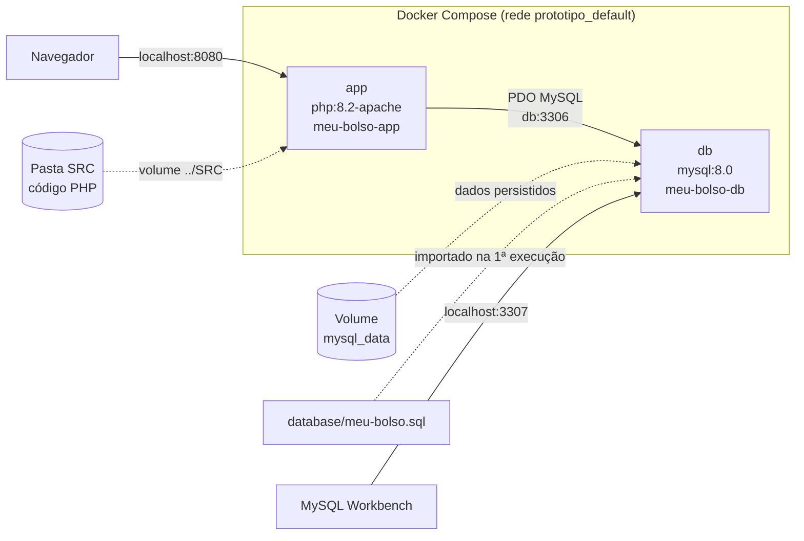

# Meu Bolso: arquitetura e execução com Docker

Este documento descreve como o ambiente Docker do Meu Bolso está organizado e como rodá-lo.

## 1. Visão geral da arquitetura



O projeto usa dois containers orquestrados pelo Docker Compose:

| Serviço | Imagem | Container | Porta (host → container) | Função |
|---------|--------|-----------|--------------------------|--------|
| `app` | `php:8.2-apache` (build do `Dockerfile`) | `meu-bolso-app` | `8080 → 80` | Servidor web e aplicação PHP |
| `db` | `mysql:8.0` | `meu-bolso-db` | `3307 → 3306` | Banco de dados MySQL |

### Como as partes se conectam

- **Navegador → app:** o usuário acessa `http://localhost:8080`, e o Apache dentro do container `app` executa o PHP.
- **app → db:** o PHP conecta via PDO usando o nome do serviço como host (`db`) e a porta interna `3306`.
- **Código ao vivo:** a pasta `SRC` é montada em `/var/www/html` no container (`../SRC:/var/www/html`). Editou um arquivo PHP, basta atualizar a página.
- **Persistência:** os dados do MySQL ficam no volume nomeado `mysql_data`, então sobrevivem a `docker compose down`.
- **Carga inicial:** o `database/meu-bolso.sql` é importado automaticamente **apenas quando o volume do banco é novo**.
- **Acesso externo ao banco:** a porta `3307` do computador dá acesso ao MySQL (por exemplo, pelo Workbench). Dentro do Docker, a aplicação usa `3306`.
- **Charset:** o MySQL sobe com `utf8mb4` e a conexão PDO usa `charset=utf8mb4`, evitando acentos quebrados.

## 2. Estrutura do repositório

```
meu-bolso/
├── SRC/                    # aplicação PHP (montada no container app)
│   ├── classes/            # Categoria, Relatorio, SenhaReset, Transacao, Usuario
│   ├── pages/              # telas (cadastro, login, nova_transacao, ...)
│   ├── conecta.example.php # modelo da conexão com o banco
│   ├── conecta.php         # conexão real (NÃO versionado)
│   └── index.php           # página inicial
├── database/
│   ├── meu-bolso.sql
│   ├── meu-bolso-modelo-logico.mwb
│   └── documentacao-banco-de-dados.md
├── docs/                   # documentação e requisitos
├── prototipo/
│   ├── Dockerfile          # imagem do serviço app
│   └── compose.yaml        # definição dos serviços app e db
└── README.md
```

## 3. Banco de dados

O script `meu-bolso.sql` cria o banco `meu_bolso` com as tabelas `usuarios`, `categorias`, `transacoes` e `redefinicoes_senha`. Mais detalhes em `database/documentacao-banco-de-dados.md`.

## 4. Arquivos do Docker

**`prototipo/Dockerfile`**

```dockerfile
FROM php:8.2-apache

# Instala as extensões necessárias para conexão com MySQL
RUN docker-php-ext-install pdo pdo_mysql

# Habilita o módulo de reescrita do Apache
RUN a2enmod rewrite

# Define a pasta da aplicação
WORKDIR /var/www/html
```

**`prototipo/compose.yaml`**

```yaml
services:
  app:
    build: .
    container_name: meu-bolso-app
    ports:
      - "8080:80"
    volumes:
      - ../SRC:/var/www/html
    depends_on:
      - db

  db:
    image: mysql:8.0
    command: --character-set-server=utf8mb4 --collation-server=utf8mb4_unicode_ci
    container_name: meu-bolso-db
    environment:
      MYSQL_ROOT_PASSWORD: meu_bolso_dev
      MYSQL_DATABASE: meu_bolso
    ports:
      - "3307:3306"
    volumes:
      - mysql_data:/var/lib/mysql
      - ../database/meu-bolso.sql:/docker-entrypoint-initdb.d/meu-bolso.sql

volumes:
  mysql_data:
```

## 5. Como rodar

### Pré-requisitos

- [Docker Desktop](https://www.docker.com/products/docker-desktop/) instalado e aberto (aguarde o **Engine running**)
- Git

### Passo a passo

1. Clone o repositório, de preferência fora do OneDrive:

   ```powershell
   git clone https://github.com/Rebecca-ADS/meu-bolso.git
   cd meu-bolso
   ```

2. Crie o arquivo de conexão a partir do modelo:

   ```powershell
   Copy-Item SRC\conecta.example.php SRC\conecta.php
   ```

   Edite `SRC/conecta.php` com: host `db`, porta `3306`, banco `meu_bolso`, usuário `root`, senha `meu_bolso_dev`.

3. Suba os containers:

   ```powershell
   cd prototipo
   docker compose up -d --build
   ```

4. Acesse **http://localhost:8080**.

Na primeira execução, aguarde cerca de 1 minuto para o MySQL importar o `.sql`.

### Comandos úteis

| Ação | Comando |
|------|---------|
| Subir o projeto | `docker compose up -d` |
| Parar o projeto | `docker compose down` |
| Ver logs | `docker compose logs app` ou `docker compose logs db` |
| Listar tabelas | `docker compose exec db mysql -uroot -pmeu_bolso_dev meu_bolso -e "SHOW TABLES;"` |
| Recriar o banco do zero (apaga os dados) | `docker compose down -v` e depois `docker compose up -d` |

### Acesso externo ao banco

No MySQL Workbench: host `127.0.0.1`, porta `3307`, usuário `root`, senha `meu_bolso_dev`.

## 6. Problemas comuns

| Sintoma | Causa provável | Solução |
|---------|----------------|---------|
| `failed to connect to the docker API` | Docker Desktop fechado | Abra o Docker Desktop e aguarde o Engine running |
| `no configuration file provided` | Terminal fora da pasta `prototipo` | `cd prototipo` e repita o comando |
| "Forbidden" no navegador | Volume apontando para pasta sem `index.php` | Confira `../SRC:/var/www/html` no `compose.yaml` |
| Cadastro falha / tabela inexistente | Banco criado sem importar o `.sql` | `docker compose down -v` e `docker compose up -d` |
| Acentos quebrados (`ç`) | Importação com charset errado | Recrie o banco com `down -v`; o compose já força UTF-8 |
| `port is already allocated` | Porta em uso | Troque o número da esquerda em `ports` |

## 7. Segurança e boas práticas

- As credenciais deste documento (`root` / `meu_bolso_dev`) são **apenas para desenvolvimento local**. Nunca as use em produção.
- O `SRC/conecta.php` contém a senha e **não deve ser versionado**. Só o `conecta.example.php` vai para o GitHub.
- Evite `docker compose down -v` fora do caso de recriar o banco, pois ele apaga os dados.
- Trabalhe em uma pasta fora do OneDrive (por exemplo `C:\projetos`) para evitar problemas com arquivos "só na nuvem" nos volumes do Docker.
